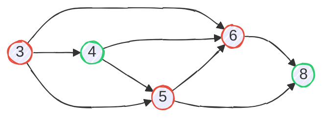

Here is the problem from [Codeforces Round 1103](https://codeforces.com/contest/2236/problem/D). You can read the original problem but I will frame the problem here in my own words. This problem is a good mix of **Dynamic Programming** and **Combinatorial Game Theory**.

## Problem Statement

In a 2 player game on array `A[1..n]` and integer `k`. Player A and B both take turns one by one. Players have to choose a number given below conditions:

- Let the previosly chosen element be $x$.
- A player must choose a element $y$, s.t. $ x \leq y \leq x + k$, and $y$ will be removed from the array.

A has given oppurtinity to start the game, A can move initially without any restrictions (setting the base $x$). Then the game will start from A, taking turns one by one. A will move twice in the starting and then normal game will continue (A, A, B, A, B, A, B...). The player who cannot make a move loses. Is it possible for A to initially choose a number that he is gauranteed to win?

## Solution

We will take this as e.g.: `A = [3, 4, 6, 5, 8]` and `k = 3`, also elements can **repeat** we will come to that part later. Also $y$ will always be greater than or equal to $x$, we can arrange our original array in increasing order, `A = [3, 4, 5, 6, 8]`.

If a player chooses $a_i$, next move can be $a_j,\ s.t.\ j \geq i\ and\ a_i \leq a_j \leq a_i + k$. We can model this as a Directed Acyclic Graph. For the above e.g., the graph will look something like below.



- **P-positions**: Positions which are winning for the previous player (the player who just moved). Marked as green.
- **N-positions**: Positions which are winning for the nex player. Marked as red.
- a position in a game is called **terminal position**, if no moves are possible from it.

For A to win, we need a position that is a N-position because A will move twice in starting, A can move from there to a P-position and the game will continue. We will work backwards from the end of the game to the beginning (**backwards induxtion** ).

1. Every terminal position will be P, as no moves are possible from there the player who just moved will win.
2. if a position is connected to P-position, that position will be N-positions. Next player can make a move to P-position and he will be gauranteed to win. For e.g. 3 is connected to 5, 6 (N-positions) and 4 (P-position), if a player moves 3, next player can move 4.
3. Positions that are connected only to N-positions, are automatically P-positions.

We have not taken repeatition in account yet, with repeatition above rules will stay the same. We construct two arrays from `A[1..n]`, `uniq[1..k]` with unique elements in sorted order and `cnt[1..k]` with $cnt_i := count(uniq_i)$. A player is at $uniq_i$, next player can either move to $uniq_j,\ j\> i\ and\ uniq_j \leq uniq_i + k$ or can move from $cnt_i - 1$ remaining elements of the same number.

If we create a DAG using only unique elements and mark the positions. Any P-position which is repeated even number of times will become N-position because it is always connected to N-positions, every player will move same number because it is only connected to N-positions but in the last next player will have their turn, so it becomes a N-position. Other positions will remain same.

Now we need to see if there is a N-position in the game, if yes A is gauranteed to win.

Below is my code for the problem in _C++_ .

```cpp
void solve() {
  uint32_t n, k;
  cin >> n >> k;
  vector<uint32_t> a(n);
  for (auto &i : a)
    cin >> i;

  map<uint32_t, uint32_t> mp;
  for (const auto &i : a) {
    mp[i]++;
  }

  // uniq will have sorted unique numbers
  vector<uint32_t> uniq;
  for (const auto &i : mp)
    uniq.push_back(i.first);

  auto len = uniq.size();
  uint32_t dp[len];

  // index will contain P-positions
  set<uint32_t> index;
  for (int i = len - 1; i >= 0; i--) {
    auto range_min =
        lower_bound(uniq.begin() + i + 1, uniq.end(), uniq[i]) - uniq.begin();
    auto range_max =
        upper_bound(uniq.begin() + i + 1, uniq.end(), uniq[i] + k) -
        uniq.begin();

    auto cnt = mp[uniq[i]] % 2;
    auto it = index.lower_bound(range_min);
    if (it != index.end() && *it < range_max) {
      dp[i] = 0;
    } else {
      dp[i] = cnt;
      if (cnt)
        index.insert(i);
    }
  }

  if ((count(dp, dp + len, 0U))) {
    yes();
  } else
    no();
}
```
